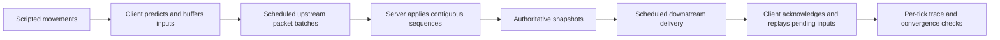

# NetSync Lab

**A reproducible C++20 experiment in client prediction, authoritative state, and bounded retransmission.**

NetSync Lab is an independent, single-client/server movement simulator for exploring how delayed, dropped, and out-of-order packets affect state agreement. Instead of relying on live servers or network hardware, it uses explicit, deterministic fault schedules so a failure can be reproduced and tested.

**Engineering question:** Can bounded retransmission reduce the number of command entries sent without losing reliable convergence—and what does that choice cost?

[Read the engineering case study](docs/case-study.md) · [Inspect the protocol and invariants](docs/design.md) · [View the exact comparison data](evidence/retransmission-comparison.csv)

## Results at a glance — v0.2

The original baseline sends **all** outstanding commands every simulated tick. The bounded policy sends up to **three oldest unacknowledged commands every two ticks**. Both receive the same 12 scripted movement inputs and cyclic fault *rules*.

| Synthetic metric | Full-batch baseline | Bounded retransmission |
| --- | ---: | ---: |
| Final convergence | Yes | Yes |
| Simulated ticks to converge | 14 | 19 |
| Upstream packets sent | 14 | 10 |
| Command entries placed in upstream packets | 33 | 27 |
| Largest upstream batch | 4 | 3 |
| Peak client/server position gap | 1 | 2 |

**Tradeoff:** The bounded policy sends **18.2% fewer command entries**, but takes **35.7% more simulated ticks** to converge and has a larger temporary state gap in this scenario. These are **synthetic event counts**, not bandwidth, RTT, frame time, or online game measurements. Because faults are indexed by send order, changing the send schedule also changes which transmissions are dropped; do not generalize the numbers without additional controls.

[Comparison methodology and limitations](evidence/retransmission-validation.md) · [Machine-checkable CSV](evidence/retransmission-comparison.csv)

## Verified engineering evidence

| Check | Verified result | Evidence |
| --- | --- | --- |
| Local Windows 10 / MSVC 19.51 | **29/29** C++ cases, **7/7** CLI cases, **6/6** CTest entries | [Windows v0.2 validation](evidence/windows-v02-validation.md) |
| Local Linux / GCC 14 and Clang 17 | **29/29** C++ cases, **7/7** CLI cases, **6/6** CTest entries; identical comparison CSV | [v0.2 comparison validation](evidence/retransmission-validation.md) |
| Hosted GitHub Actions / Windows and Ubuntu | **Both jobs passed**, including configure, build, CTest and source hygiene | [v0.2 hosted CI evidence](evidence/ci-v02-validation.md) |

The v0.2 post-merge `main` build is recorded at [GitHub Actions run #43689844368](https://github.com/Preciouscrazy/NetSyncLab/actions/runs/43689844368), for commit [`3d72b82`](https://github.com/Preciouscrazy/NetSyncLab/commit/3d72b82399a1fe3c05e28a38da093718c489b497).

## Run it

Requires **CMake 3.20+**, a **C++20 compiler**, and **Python 3 for the configured CLI tests and source-hygiene scan** (not for running the compiled simulator). No external runtime libraries.

### Windows PowerShell — Visual Studio 2026

```powershell
cmake -S . -B build -G "Visual Studio 18 2026"
cmake --build build --config Debug
ctest --test-dir build -C Debug --output-on-failure

.\build\Debug\netsync.exe compare
.\build\Debug\netsync.exe demo
.\build\Debug\netsync.exe trace
python tools\check_text.py
```

### Linux — GCC or Clang

```bash
cmake -S . -B build -DCMAKE_BUILD_TYPE=Debug
cmake --build build
ctest --test-dir build --output-on-failure

./build/netsync compare
./build/netsync demo
./build/netsync trace
python3 tools/check_text.py
```

`compare` prints the two-policy CSV summary to stdout. `demo` runs the original scripted-loss scenario; `ideal` is the zero-delay/zero-loss reference; `trace` prints per-tick CSV data. Existing v0.1 modes retain their original output, covered by CLI golden-output tests.

## How it works



- **Prediction:** Local movement happens immediately; the client retains unacknowledged commands.
- **Authority:** The server buffers out-of-order commands and applies contiguous sequence numbers once.
- **Reconciliation:** The client accepts newer acknowledgments, replaces its authoritative baseline, and reapplies pending inputs.
- **Retransmission:** The baseline resends the full pending batch; v0.2 optionally caps batch length and transmission frequency.

The simulator uses a **single bounded integer position**, discrete ticks and scripted packet scheduling—not actual UDP/TCP sockets. See [the full design](docs/design.md) for validation rules and known limitations.

## Repository map

| Location | Purpose |
| --- | --- |
| [`include/netsync/`](include/netsync) / [`src/`](src) | Client/server model, packet scheduler, simulation and CLI |
| [`tests/test_main.cpp`](tests/test_main.cpp) | 29 C++ regression cases |
| [`tests/test_cli.py`](tests/test_cli.py) | 7 CLI cases, including exact comparison CSV |
| [`.github/workflows/ci.yml`](.github/workflows/ci.yml) | Hosted Windows and Ubuntu build, tests and source hygiene |
| [`docs/case-study.md`](docs/case-study.md) | Engineering problem, decisions, validation and tradeoffs |
| [`docs/design.md`](docs/design.md) | Protocol details and invariants |
| [`evidence/`](evidence) | Local/hosted validation, original demo trace, comparison CSV |

## Boundaries

This is a **deterministic educational prototype**, not a production networking stack or a Riot Games integration. There are no real players, sockets, authentication, anti-cheat controls, packet-byte budgets, RTT-based retransmission, congestion control, interpolation, or real-world latency measurements. The experiment confirms behavior for its stated fault patterns; it cannot establish performance or security on live multiplayer networks.
