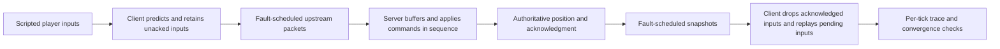

# NetSync Lab

**Deterministic multiplayer-network simulation | C++20 | CMake | automated regression tests**

NetSync Lab models a simplified client/server movement protocol using **scripted packet latency, packet loss, packet reordering, local input prediction, authoritative server processing, acknowledgments, and client reconciliation**. The goal is to make network timing bugs reproducible without actual sockets or access to a commercial game.

**Scope:** Independent educational prototype using synthetic inputs. It does not connect to Riot Games, measure actual game latency, provide a secure game protocol, or represent a production networking stack.

## Build and test

Requires **CMake 3.20+** and a **C++20 compiler**. **Python 3** is required for the optional CLI integration tests/source-hygiene scan in the CMake test configuration, not at application runtime. No external runtime libraries.

### Windows PowerShell — Visual Studio 2026

```powershell
cmake -S . -B build -G "Visual Studio 18 2026"
cmake --build build --config Debug
ctest --test-dir build -C Debug --output-on-failure
.\build\Debug\netsync_tests.exe
.\build\Debug\netsync.exe demo
.\build\Debug\netsync.exe trace
python tools\check_text.py
```

### Linux / macOS

```bash
cmake -S . -B build -DCMAKE_BUILD_TYPE=Debug
cmake --build build --config Debug
ctest --test-dir build --output-on-failure
./build/netsync_tests
./build/netsync demo
./build/netsync trace
python3 tools/check_text.py
```

## Example output

Run `netsync demo`:

```text
ticks=14
issued_inputs=12
server_ack=12
client_ack=12
server_position=14
predicted_position=14
peak_state_gap=1
upstream_sent=14
upstream_dropped=3
upstream_reordered=5
downstream_sent=14
downstream_dropped=4
downstream_reordered=2
converged=true
```

Run `netsync ideal` for a zero-delay/zero-loss control scenario. Run `netsync trace` for **CSV written to stdout** with tick-by-tick authoritative/predicted positions and acknowledgment progress; redirect it to a file if desired. No file input/output is required for the starter.

### What these numbers mean

- **Tick:** an integer simulation step, **not** a fixed number of milliseconds.
- **Sent/dropped:** counts of simulated *whole packets*, not real network traffic or a measured packet-loss rate.
- **Reordered:** a packet arriving after another that was transmitted later on the *same link*.
- **Peak state gap:** maximum absolute difference between the client's predicted position and the server's current position at the end of a simulated tick; **not** a real-world gameplay latency or accuracy benchmark.
- **Converged:** the server has processed every issued input, the client has acknowledged them, and predicted and authoritative positions match before the drain limit.

## Design sketch



The server is authoritative: it processes commands **exactly once and in sequence**, even when delivery is duplicated or out of order. A sent upstream packet carries the **full list of currently unacknowledged commands**. This simple redundancy helps recover from single-packet loss without implementing retransmission timers. A returned snapshot acknowledges a contiguous sequence; the client then replays remaining local inputs to recalculate its predicted position.

## Source layout

```text
include/netsync/model.hpp       Client, Server, command and snapshot types
include/netsync/network.hpp     Scripted in-memory packet scheduling and counters
include/netsync/simulation.hpp  Scenario and per-tick result API
src/model.cpp                   Input validation and prediction/reconciliation
src/simulation.cpp              Simulation loop and deterministic scenarios
src/main.cpp                    Small CLI: demo, ideal, trace, help
tests/test_main.cpp             C++ unit tests for gameplay/network edge cases
tests/test_cli.py               Golden CLI output and exit-status tests
.github/workflows/ci.yml        Windows and Ubuntu CMake/CTest pipeline
docs/design.md                  Protocol semantics, invariants, limitations
evidence/local-validation.md    Real environment-specific test evidence
```

## Test coverage

The starter includes **23 C++ unit tests**, **5 Python standard-library CLI tests**, and **5 CTest checks** (C++ suite, three example command invocations, and CLI golden-output suite). Tests cover loss, delay, reordering, duplicate command delivery, stale snapshots, erroneous sequence/position values, prediction replay, stable output, non-convergence under complete link failure, and CLI errors. **Cross-platform GitHub Actions verified:** The initial push to `main` (commit [`d3af238`](https://github.com/Preciouscrazy/NetSyncLab/commit/d3af23800d978d6dfb968f68a2e49d8d86abbdd7)) passed the CMake build, all five CTest checks, and the source-hygiene scan on both **Windows** and **Ubuntu**. See the [successful workflow run](https://github.com/Preciouscrazy/NetSyncLab/actions/runs/43688559330) and [CI validation record](evidence/github-actions-validation.md).

## Intentional boundaries

- One integer position per simulated player; no interpolation, physics, rollback, real players, authentication, or security protections.
- Discrete ticks and deterministic, cyclic fault patterns; not real UDP/TCP, timestamps, jitter statistics, or validated network latency models.
- Redundant command batches are bounded for this prototype but inefficient in long-running simulations.
- The demo ends as soon as issued commands are acknowledged; packets still in flight may be ignored after convergence.
- A stable final state does not prove optimal prediction quality or production safety.

See [design details](docs/design.md), [local validation evidence](evidence/local-validation.md), [reproducible demo summary](evidence/demo-summary.txt), and [per-tick trace](evidence/demo-trace.csv). The local Linux and Windows validation logs are dated evidence; the linked GitHub Actions run independently verifies hosted Windows and Ubuntu builds. All results use synthetic scenarios, not production networking measurements.

## v0.2: bounded retransmission experiment

`netsync compare` runs the same scripted input and cyclic fault patterns using two retry policies: baseline (all pending commands every tick) and bounded (at most three oldest pending commands every two ticks). It prints a CSV comparison. The original `demo`, `ideal`, and `trace` modes remain unchanged.

The deterministic local comparison showed **33 vs 27 transmitted command entries**, but **14 vs 19 ticks to converge** and **1 vs 2 peak position gap**. These are synthetic simulation counters, **not** real bandwidth or latency measurements. See [the evidence and methodology](evidence/retransmission-validation.md) and [the checked-in CSV](evidence/retransmission-comparison.csv).

The v0.2 suite includes **29 C++ unit tests, 7 CLI tests, and 6 CTest entries**, verified on GCC 14 and Clang 17. Windows and GitHub CI for v0.2 require a separate check.
