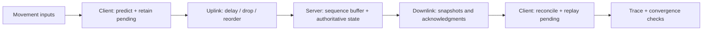

# NetSync Lab v0.2 — Engineering case study

**Domain:** Game-networking concepts · **Language:** C++20 · **Format:** deterministic, in-memory simulation

[Project overview](../README.md) · [Implementation details](design.md) · [Measured comparison CSV](../evidence/retransmission-comparison.csv) · [Hosted CI evidence](../evidence/ci-v02-validation.md)

## Problem

In a client/server movement system, the player should not have to wait for a server response before seeing a local movement. The client predicts the result immediately, while a server processes inputs in sequence and returns authoritative snapshots. Delays, packet drops and out-of-order delivery can leave the two temporarily out of sync.

A simple recovery strategy is to resend **every unacknowledged command on every simulation tick**. It is easy to reason about, but its batches can grow when acknowledgments are delayed. NetSync Lab v0.2 asks a narrower question: **Can a bounded, slower resend policy reduce attempted command payload while preserving eventual convergence in a fixed fault scenario?**

The project is an independent educational model of networking principles, not a connection to any commercial game.

## Design and responsibilities



The implementation keeps these responsibilities separate:

| Component | Responsibility | Main files |
| --- | --- | --- |
| Client and server model | Validate movement; issue sequence numbers; predict, buffer and reconcile; apply server commands contiguously | [`model.hpp`](../include/netsync/model.hpp), [`model.cpp`](../src/model.cpp) |
| Packet link | Deterministic packet scheduling, drops and out-of-order delivery | [`network.hpp`](../include/netsync/network.hpp) |
| Simulation | Run fixed scenarios, enforce retransmission policy, record per-tick state and event counts | [`simulation.hpp`](../include/netsync/simulation.hpp), [`simulation.cpp`](../src/simulation.cpp) |
| CLI | Execute baseline, bounded comparison and trace output | [`main.cpp`](../src/main.cpp) |
| Verification | Unit invariants, loss scenarios, deterministic CLI/golden CSV and CI | [C++ tests](../tests/test_main.cpp), [CLI tests](../tests/test_cli.py), [workflow](../.github/workflows/ci.yml) |

### Protocol contract

Each command has an increasing sequence number and a movement of -1, 0 or +1. Positions start at 10 and are clamped to [0, 20]. The server only applies a contiguous run of sequence numbers, so out-of-order packets cannot skip a missing input. Duplicate commands are not reapplied. A snapshot acknowledges the server's latest contiguous sequence and returns its authoritative position.

When the client receives a newer snapshot, it removes acknowledged commands, takes the authoritative position as its baseline, and replays outstanding inputs. Older snapshots are ignored. The test suite includes a forced corrective snapshot and stale acknowledgments.

## Decision: bounded retransmission

The original policy sends the full pending command list on each tick with unacknowledged inputs. The new policy adds two validated configuration fields to `Scenario::retransmission`:

- `max_commands_per_packet`: largest number of oldest unacknowledged commands included in each attempted uplink packet.
- `resend_interval_ticks`: fixed integer interval at which an upstream batch may be sent.

Defaults preserve the original behavior. The v0.2 comparison uses **at most 3 commands per upstream packet, sent every 2 simulation ticks**. The protocol still resends oldest unacknowledged commands first; this is go-back-N-style redundancy, not selective acknowledgments, an adaptive timeout or transport congestion control.

**Why the oldest inputs?** The server applies only contiguous sequence numbers, so earlier missing inputs can prevent later buffered commands from advancing the authoritative state. Prioritizing those earlier inputs keeps the policy easy to test.

## Experiment and results

The command `netsync compare` executes the same 12 movement inputs, starting state and cyclic upstream/downstream fault patterns with the two retransmission configurations. Results are committed verbatim at [`evidence/retransmission-comparison.csv`](../evidence/retransmission-comparison.csv) and checked byte for byte by the CLI test suite.

| Measurement | Original full-batch | Bounded v0.2 |
| --- | ---: | ---: |
| Converged with all 12 acknowledged | Yes | Yes |
| Discrete ticks to convergence | 14 | 19 |
| Attempted upstream packets | 14 | 10 |
| Attempted command entries | 33 | 27 |
| Maximum attempted batch | 4 | 3 |
| Peak position gap (grid cells) | 1 | 2 |
| Dropped upstream packets | 3 | 2 |

In this scenario, the bounded approach placed **6 fewer command entries** into simulated packets (**18.2% reduction**) and attempted **4 fewer upstream packets** (**28.6% reduction**). The tradeoff was **5 extra ticks to converge** (**35.7% increase**) and a larger temporary difference between predicted and server positions.

### What was and was not controlled

The **input sequence**, initial state and **cyclic fault rules** were fixed. However, fault patterns advance per *sent packet*, so changing how frequently packets are sent changes **which packets** experience drops and delays. The two runs are therefore **not paired packet-for-packet under identical loss events**. The comparison is deterministic and fair about its stated setup, but cannot establish a universal superiority claim.

`command_entries_sent` counts command objects included in attempted uplink payloads, **including dropped packets**. It is neither unique command count nor byte throughput. A tick has **no assigned millisecond duration**. The peak gap is measured in **integer grid cells**, not real-world player latency or frame-time jitter.

## Tests and reproducibility

| Environment | Evidence |
| --- | --- |
| Windows 10, MSVC 19.51 / Visual Studio 2026 | [29/29 C++ tests, 7/7 CLI tests, 6/6 CTest entries](../evidence/windows-v02-validation.md) |
| Linux, GCC 14 and Clang 17 | [Local build and deterministic output evidence](../evidence/retransmission-validation.md) |
| GitHub-hosted Windows and Ubuntu | [Successful post-merge build and tests at `3d72b82`](../evidence/ci-v02-validation.md) |

Tests cover invalid inputs and policy limits; contiguous processing and duplicate command handling; packet loss/delay/reordering; stale snapshot rejection; authoritative correction; deterministic repeated runs; one-command batch caps; complete upstream and downstream failure; and exact `compare` CSV output. The original `demo`, `ideal` and `trace` command behavior is retained by regression tests.

To reproduce the published experiment after building:

```bash
ctest --test-dir build --output-on-failure
./build/netsync compare
```

On Windows, use `ctest --test-dir build -C Debug --output-on-failure` and `.\build\Debug\netsync.exe compare`.

## Limitations and follow-up questions

- One bounded integer position, one client and one server; no multiplayer world simulation, physics, interpolation or rollback.
- Scripted network faults, no real sockets or packet-byte measurements.
- The fixed resend interval does not estimate round-trip time or respond to congestion.
- The current comparison contains **one fixed scenario**; conclusions about general traffic and responsiveness require a matrix of workloads and independently controlled fault sequences.
- Under complete upstream or downstream failure, convergence cannot be guaranteed; the simulation has a bounded drain window.

A useful follow-up would evaluate several batch caps and resend intervals against *matched packet-fault conditions*, plotting attempted command entries against convergence ticks and peak state gap. Another would model packet overhead in bytes and maximum queuing delay. Those experiments are **not implemented here**.

## Interview-ready explanation

> I built a deterministic C++20 model of client prediction and server reconciliation to test networking decisions without depending on live servers. The server applies numbered commands contiguously, while the client replays its unacknowledged inputs after authoritative updates. In v0.2 I added bounded retransmission and compared it with a full-batch baseline under scripted packet faults. It sent 27 command entries instead of 33, but took 19 ticks instead of 14 to converge, so I documented the traffic-versus-responsiveness tradeoff. I validated the behavior with C++ and CLI regression tests, my local Windows MSVC build, and Windows/Ubuntu CI. The results are synthetic, not real-network latency measurements.
