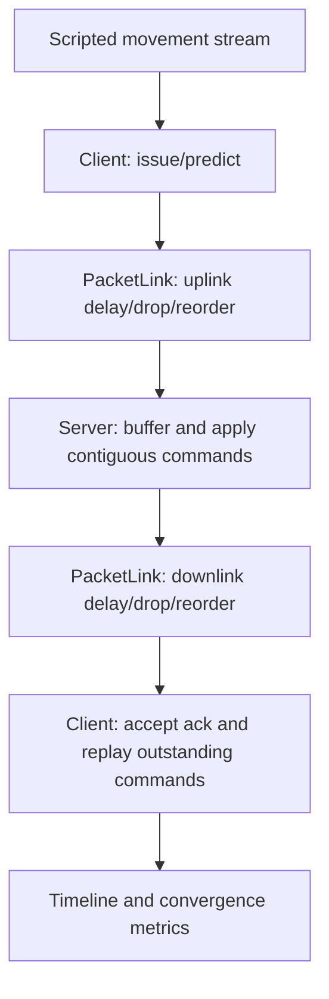

# NetSync Lab: engineering design notes

## Objective

Build a tiny, inspectable model of input prediction and server reconciliation under packet delay, drop and reordering. Every observable outcome must come from explicit integer rules and a deterministic schedule; no sockets, clocks, random-number generator or third-party dependencies are involved.

## Simplified protocol

1. **Inputs:** On each active tick the client issues a command with monotonically increasing sequence numbers beginning at 1 and movement in `{-1,0,+1}`. Position is clamped to `[0,20]` with initial position 10.
2. **Prediction:** The client immediately applies the command locally and keeps every input that has not yet been acknowledged.
3. **Upstream transmission:** Each tick with pending inputs sends a batch of *all* unacknowledged commands. Packets have send-order-driven cyclic delay/drop settings. A delay of zero means delivery in the same simulation tick.
4. **Authoritative server:** Commands are buffered by sequence. Only contiguous commands starting at `last_ack + 1` are processed; duplicate deliveries are idempotent. Conflicting duplicate values for an already-buffered sequence are rejected.
5. **Downstream snapshots:** The server sends a snapshot `(last_contiguous_sequence, authoritative_position)` every simulation tick, even when no input is applied. Snapshots can also be delayed or dropped.
6. **Reconciliation:** The client ignores stale or duplicate acknowledgments, replaces its authoritative baseline with an accepted snapshot, removes acknowledged commands, then reapplies outstanding inputs in order.
7. **Drain:** After scripted inputs finish, network steps continue (bounded by `drain_ticks`) so dropped commands and snapshots can be retried. A scenario *converges* only if all inputs were applied and acknowledged and the two positions match.

Delivery order is deterministic: packet due-tick ascending, then original send ordinal for ties. The `reordered` counter increments if a packet arrives after another packet that had a higher send ordinal on the same simulated link.

## Invariants

- `client.last_acknowledged <= client.last_issued`.
- `server.last_acknowledged` progresses contiguously, never skipping input sequences.
- Accepted snapshots never lower the client's acknowledged sequence.
- Every applied movement remains within `[0,20]`.
- A lost packet does not directly remove a client command; it remains in the unacknowledged batch.
- The exact same scenario reproduces the same per-tick trace and counters on supported compilers.

## Architecture

## Failure handling

- Invalid movement values, impossible positions, zero/oversize sequence IDs, empty fault patterns, and delays beyond the configured cap are rejected.
- The server does not apply out-of-order inputs before missing earlier commands arrive.
- A delayed snapshot cannot roll back a newer acknowledgment.
- Complete upstream loss prevents the server from processing inputs; complete downstream loss prevents the client from learning server acknowledgments. The simulation returns `converged=false` after its bounded drain interval.
- The CLI returns `0` for convergence, `1` for non-convergence, and `2` for invalid usage or exceptions.

## Engineering tradeoffs

| Choice | Benefit | Limitation |
| --- | --- | --- |
| Integer, fixed-step movement | Stable, auditable results | Not a real-time physics engine |
| Re-send all unacknowledged inputs | Recovers from loss without timers | Packet payload grows with pending inputs |
| Contiguous sequence acknowledgment | Simple ordering model | No selective acknowledgments or RTT estimation |
| Cyclic fault schedule | Fully reproducible tests | Not statistically realistic packet loss |
| Static CSV trace | Easy to inspect and compare | No interactive visual dashboard or real telemetry |
| Snapshot every tick | Simple protocol | Excessive traffic in real games |

## Known limitations and next milestones

This simulator does not model independent networked players, true network sockets, encryption, authentication, acknowledgment spoofing, clock drift, server tick rates, interpolation, snapshots of complete world state, jitter buffers, network bandwidth or packet-size limits. Convergence with these synthetic patterns does not imply production safety or real game performance.

A focused future experiment could introduce bounded command batches plus explicit retransmission and measure the resulting tradeoff between retransmission overhead and state-gap duration. Another experiment could add a separate, tested rollback model; do not mix it into this initial scope.

## v0.2 bounded retransmission

`Scenario::retransmission` adds two validated parameters: `max_commands_per_packet` (1..100000) and `resend_interval_ticks` (1..10000). Defaults reproduce the v0.1 full-batch behavior. At every interval boundary, a packet includes the **oldest unacknowledged commands** up to the configured cap; existing server-side contiguous-sequence application and client-side reconciliation remain unchanged.

The metrics `Result::upstream_command_entries_sent` and `largest_upstream_batch` count attempted upstream payload entries and peak batch size, **including packets that are later dropped**. The `compare` command uses an identical scenario and scripted fault policy except for retransmission parameters; because faults are indexed by send ordinal, the actual dropped packet set changes with the number of sends.

This is deterministic go-back-N-style retransmission rather than selective repeat, an RTT-aware timer, or congestion control. A small cap/long interval can trade lower payload volume for greater synchronization delay; see [comparison evidence](../evidence/retransmission-validation.md).
